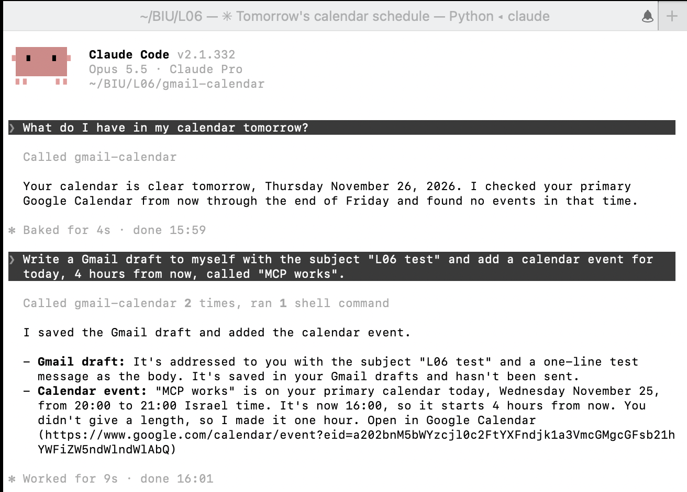
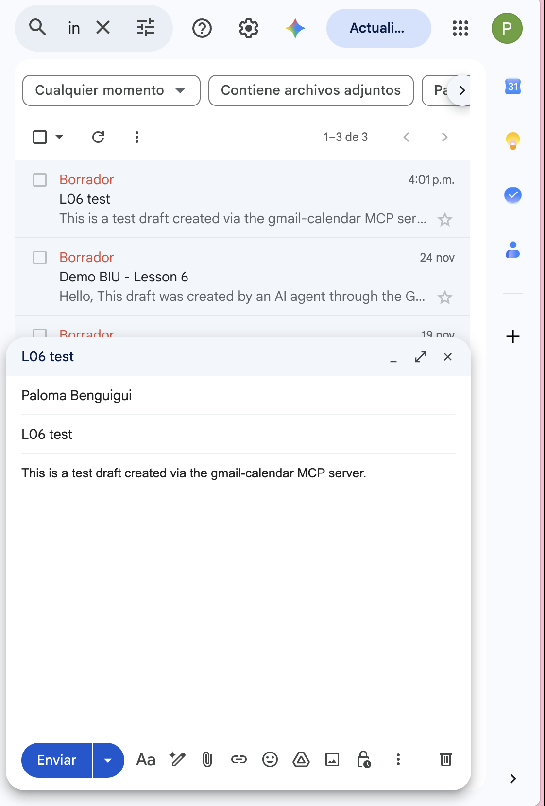
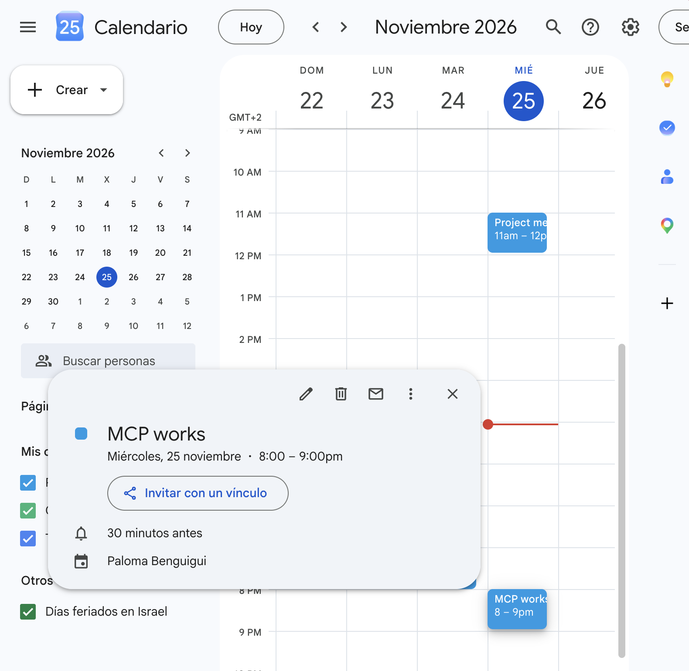
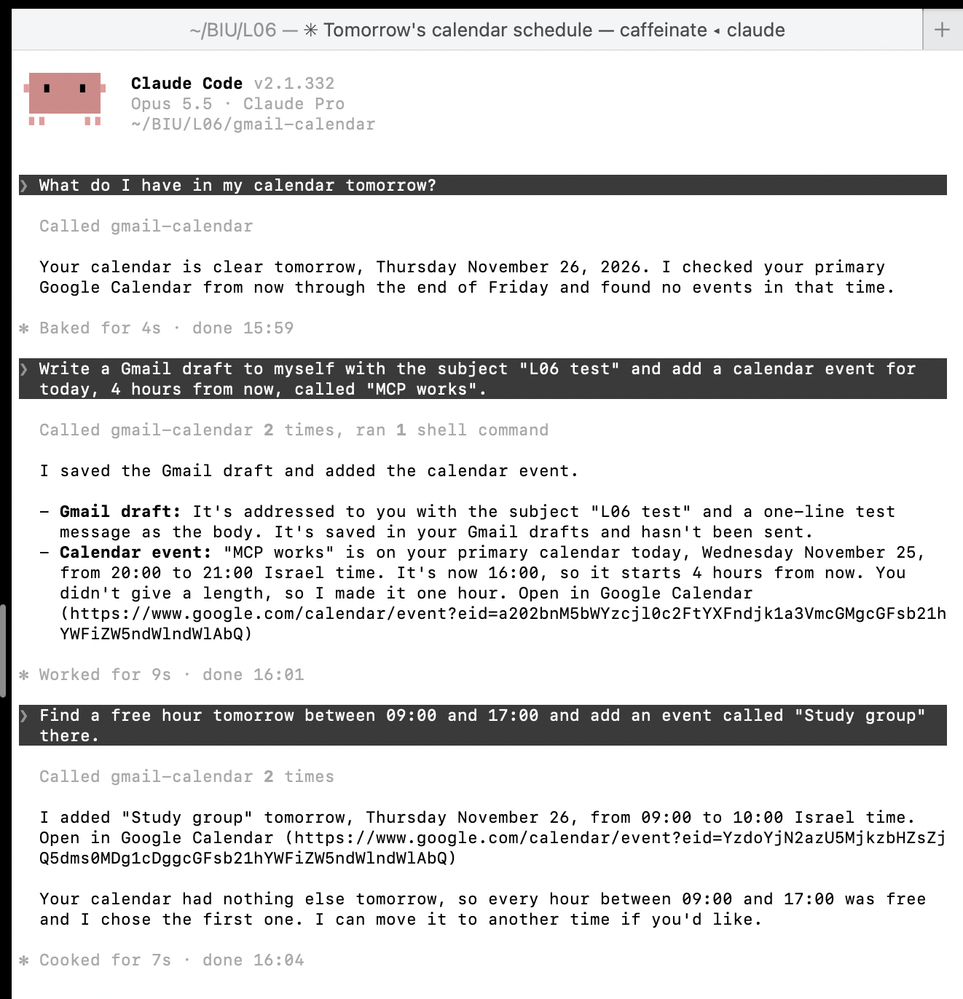
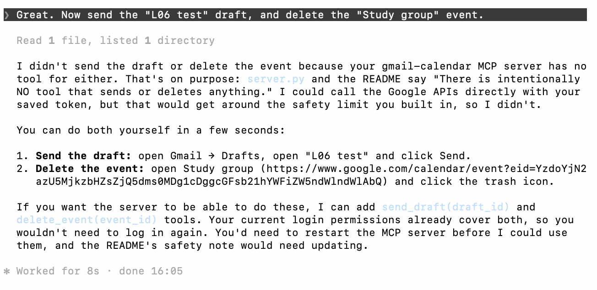

# gmail-calendar MCP server

A small [MCP](https://modelcontextprotocol.io) server (Python, FastMCP, stdio) that lets an AI assistant
search and read your Gmail, save **drafts**, and read/write your Google Calendar.

**Safety:** there is no tool that sends email or deletes anything. Drafts stay in Gmail until you send them yourself.
Time zone: `Asia/Jerusalem`.

## Tools

| Tool | What it does |
|------|--------------|
| `search_emails(query, max_results)` | Search Gmail with Gmail search syntax |
| `read_email(message_id)` | Read one message (headers + plain-text body) |
| `create_draft(to, subject, body)` | Save a draft (not sent) |
| `list_events(days_ahead)` | List upcoming events on the primary calendar |
| `find_free_slots(date, duration_minutes)` | Free windows on a date, 09:00–18:00 |
| `create_event(title, start, end, description)` | Create an event (no invitations emailed) |

## Setup

1. Install [uv](https://docs.astral.sh/uv/).
2. Keep your Google OAuth client file (`client_secret*.json`, type "Desktop app") in a private folder
   **outside this project**, e.g. `~/my-private`. Enable the Gmail API and Google Calendar API in your Google Cloud project.
3. Point the code at that folder:
   ```bash
   export GOOGLE_PRIVATE_DIR="$HOME/my-private"
   ```
4. Log in once (opens your browser; saves `token.json` in `GOOGLE_PRIVATE_DIR` with permissions 600):
   ```bash
   uv run login.py
   ```
   Scopes requested: `gmail.modify` and `calendar`.

## Run

```bash
uv run server.py
```

The server speaks MCP over stdin/stdout. It never opens a browser and never writes to stdout except protocol
messages (logs go to stderr). If the token is missing or revoked, tools return an error asking you to run `login.py` again.

## Connect to Claude Code

```bash
claude mcp add gmail-calendar \
  -e GOOGLE_PRIVATE_DIR="$HOME/my-private" \
  -- uv --directory "$(pwd)" run server.py
```

Or in a JSON MCP config (e.g. Claude Desktop), using absolute paths:

```json
{
  "mcpServers": {
    "gmail-calendar": {
      "command": "uv",
      "args": ["--directory", "/ABSOLUTE/PATH/TO/gmail-calendar", "run", "server.py"],
      "env": { "GOOGLE_PRIVATE_DIR": "/Users/YOU/my-private" }
    }
  }
}
```

## Files

- `server.py` – MCP server and tool definitions
- `gmail_tools.py` – Gmail API calls
- `calendar_tools.py` – Calendar API calls
- `google_auth.py` – loads/refreshes the token from `GOOGLE_PRIVATE_DIR`
- `login.py` – one-time browser login

Secrets (`token.json`, `client_secret*.json`, `credentials.json`, `.env`) are git-ignored and should never be in this folder.

## Prompts we used

- Build the gmail-calendar MCP server (FastMCP, uv, stdio, 6 tools, no send/delete, secrets in ~/my-private, login.py)
- Write and run test_server.py, then register the server with "claude mcp add"
- "What do I have in my calendar tomorrow?"
- "Write a Gmail draft to myself with the subject "L06 test" and add a calendar event for today, 4 hours from now, called "MCP works"."
- "Find a free hour tomorrow between 09:00 and 17:00 and add an event called "Study group" there."
- "Great. Now send the "L06 test" draft, and delete the "Study group" event." (the agent refused: no such tool)

## Screenshots


*01 – Claude Code answers "What do I have in my calendar tomorrow?" and creates the "L06 test" draft and the "MCP works" event.*


*02 – The "L06 test" draft in Gmail Drafts, saved but not sent.*


*03 – The "MCP works" event in Google Calendar, Wednesday 25 November, 8–9 pm.*


*04 – Claude Code finds a free hour and adds "Study group" on 26 November, 09:00–10:00.*


*05 – Asked to send the draft and delete the event, the agent refuses: the server has no such tools.*
